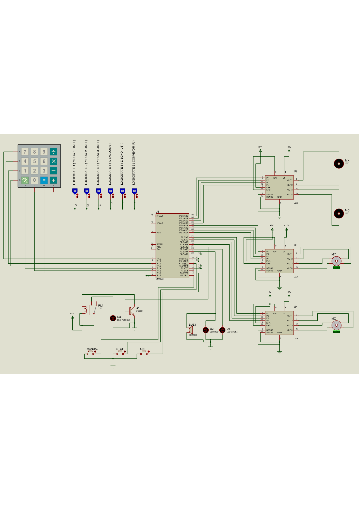

# Automated Tire Storage System (ATSS) - 8051 Microcontroller

## Project Overview
The **Automated Tire Storage System (ATSS)** is a 3-axis automated gantry mechanism designed to efficiently store and retrieve tires in an industrial warehouse. This project is built around the **8051 Microcontroller (AT89C51)** and is fully programmed in **Assembly Language**. The complete hardware logic and mechanical operations are simulated using **Proteus**.

## Key Features
* **Automated 3-Axis Gantry Control:** Controls X (horizontal), Y (cross), and Z (vertical) axes for precise positioning within a 3x3 storage grid.
* **Tire Height Detection:** Uses an HC-SR04 Ultrasonic sensor to determine the height of the tire stack before gripping.
* **Pneumatic Gripper Simulation:** Controls a solenoid valve to simulate a 3-arm tire gripper.
* **Conveyor Belt Delivery:** Automatically drops the retrieved tire onto a conveyor belt and runs it until an IR sensor detects the tire has reached the operator.
* **Emergency Override:** Features a dedicated hardware Emergency STOP (INT0) that immediately halts all motors and triggers audio/visual alarms.

## Hardware Components Used
* **Microcontroller:** 8051 (AT89C51)
* **Motors:** 
  * 2x DC Motors (X-Axis Main Rail, Conveyor Belt)
  * 2x Stepper Motors (Y-Axis Cross Rail, Z-Axis Vertical Arm)
* **Motor Drivers:** L298 Dual H-Bridge
* **Sensors:**
  * 4x3 Matrix Keypad (For Location ID input: 1-9)
  * Limit Switches (For X and Y-axis homing/positioning)
  * HC-SR04 Ultrasonic Sensor (Z-axis stack height)
  * IR Sensor (Conveyor belt presence)
* **Indicators:** Green/Red LEDs and Audible Buzzer

## Software & Tools
* **Assembly Language:** Core logic and timing control.
* **Proteus Simulation:** Circuit design and system simulation.

## How to Run the Simulation
1. Clone or download this repository to your local machine.
2. Open the `.pdsprj` file using **Proteus 8 Professional** (or higher).
3. Double-click the 8051 Microcontroller component in Proteus.
4. Under the "Program File" section, browse and select the compiled `.hex` file provided in the repository.
5. Click the **Play** button at the bottom left of Proteus to start the simulation.
6. Press the **ON Button** to initialize, and enter a tire location (1-9) on the Keypad to observe the gantry movement!

## Documentation
Block diagrams, flowcharts, and microcontroller pin-mapping details can be found in the `Documentation` folder (or attached report).